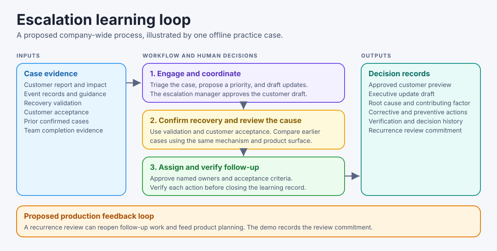
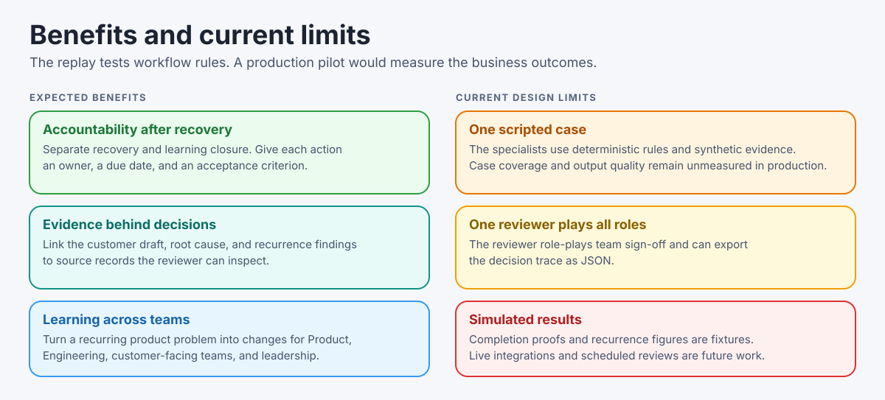
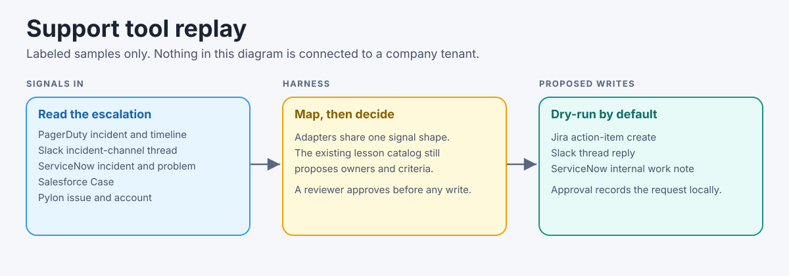

# Escalation Learning Harness

[Open the live demo](https://escalation-learning-harness.insightfulfeast.chatgpt.site) in your browser. No account or installation required.

A runnable demo that follows a critical customer escalation from the first report to customer recovery, then turns the evidence into corrective and preventive actions. The learning record closes after team owners verify their actions and an executive sponsor reviews the residual risk.



The demo replays a fictional assessment-template discard and a separate launch-picker lookalike. The agents run deterministic rules, the evidence is synthetic, and a single browser session role-plays the people making decisions. The hosted replay keeps decisions in your browser tab and requires no account or API key.

## Practice the case

1. **Engage.** Open the customer report. Run triage, inspect the discard event and rollout impact, then confirm P2. The severity rubric is fictional.
2. **Coordinate.** Review the executive brief and customer draft. Try the unsupported restore claim to see the approval block. Approve supported wording, revise it, and watch the preview lock again until the new version is approved.
3. **Confirm recovery.** Replay Support's rebuild validation and the customer's acceptance. The customer moves to **Recovered** while learning stays **Open**.
4. **Learn.** Run the RCA, recurrence, and routing stages. Two prior confirmed discard cases match. A similar launch-picker report is excluded because its mechanism is unverified.
5. **Verify.** Return Engineering’s incomplete submission, replay revised evidence, and verify the actions before executive sign-off.
6. **Review recurrence.** Load both reports after closure. Keep the filter issue separate, then reopen preventive work for a confirmed repeat. Verify revised Engineering proof and executive sign-off again. **Export JSON** saves the decision record.

[Open a screenshot of the live demo](docs/images/demo-preview.png) · [Read the rehearsal guide](docs/demo-guide.md)

## What each team owns

| Team | Follow-up in the replay |
| --- | --- |
| Engineering | Verify safeguards and regression coverage for irreversible discard |
| Product & Design | Test whether customers understand the warning before they confirm |
| Support | Publish and rehearse a decision tree for discarded drafts and missing templates |
| Customer Success | Record customer acceptance and check readiness for the next rollout |
| Documentation & Enablement | Publish safe draft-editing and rebuild guidance |
| Operations & Analytics | Measure confirmed repeat escalations per 100 draft edits |
| Executive leadership | Review residual risk after team verification and set the next review |

The escalation manager owns the case, confirms priority and recovery, approves the follow-up plan, and closes the learning record. Each action carries an owner, due date, evidence references, and an acceptance criterion. See the [roles and decisions visual](docs/images/main-players.svg).

## Benefits and boundaries



The replay demonstrates source-linked drafts, explicit recovery and closure decisions, and routing based on recurrence. The example reduction from **3 to 1 confirmed discards per 100 edits** is synthetic. A production pilot would measure repeat escalations, follow-up completion, and time to verified closure. The demo records a 30-day review commitment without scheduling it.

- [What changed and why](docs/iteration.md) compares the first release, review findings, and rerun results.
- [Design notes](docs/design.md) describe inputs, outputs, code structure, and proposed production work.
- [Rehearsal guide](docs/demo-guide.md) includes the main walkthrough and what to inspect at each decision.
- [Evaluation notes](docs/evaluation.md) explain what CI checks and what remains outside the test set.
- [Reliability notes](docs/reliability.md) record measured failure and recovery cases from the local harness. The demo does not call a model.

## Support tool integrations

The learning loop can read escalation signals from the tools a support organization already uses, and it can propose follow-ups back into those tools. The default path is offline. Every payload under `integrations/fixtures/` is a labeled sample. The demo, the unit tests, and GitHub Actions do not call ServiceNow, Pylon, Salesforce, PagerDuty, Slack, or Jira, and they do not need accounts or API keys.



| Tool | Direction in this harness | What the sample represents |
| --- | --- | --- |
| PagerDuty | In | A v3 `incident.triggered` webhook and the incident log-entry timeline |
| Slack | In, and a proposed reply | An incident-channel thread from `conversations.replies`, plus a `chat.postMessage` body that is not sent |
| ServiceNow | In, and a proposed internal note | Table API incident and problem records, plus a PATCH `work_notes` body that is not sent |
| Salesforce | In | A Service Cloud Case retrieve and a Case change event |
| Pylon | In | An issue (with its account id) and a string-valued webhook body |
| Jira | Out | A proposed `POST /rest/api/3/issue` action item for the Engineering lesson |

The cross-tool sample follows one fictional case: a PagerDuty page, the Slack thread, a resolved ServiceNow incident linked to a problem, a Salesforce Case, a Pylon issue for Example Privacy Team, the existing discard lesson, then three proposed writes. The local server exposes that replay at `/integrations-replay.json`. `python3 build_demo.py` copies it next to the static demo. Approving a write in the page records a dry-run in the browser tab. It does not create a ticket or post a message.

Live mode is optional and off unless `ELH_INTEGRATIONS_MODE=live`. Credentials are read from environment variables at call time (`SERVICENOW_INSTANCE`, `SERVICENOW_TOKEN`, `PYLON_API_TOKEN`, `SALESFORCE_INSTANCE_URL`, `SALESFORCE_ACCESS_TOKEN`, `PAGERDUTY_API_TOKEN`, `SLACK_BOT_TOKEN`, `JIRA_BASE_URL`, `JIRA_EMAIL`, `JIRA_API_TOKEN`). Even then, a write runs only after `approve()` and only when `ELH_INTEGRATIONS_DRY_RUN=0`. This repository is not connected to a company instance of any of these products. Field lists and the pages they come from are in [docs/integrations.md](docs/integrations.md).

## Maintainer verification

These commands are optional. They check the fixtures on a machine that already has the repository. They are not required to use the hosted case.

GitHub Actions runs the three Python checks below, then compares the generated browser replay with the Python scorecard. See the [workflow](.github/workflows/evals.yml). That comparison is maintainer verification. It is not a hosted evaluation panel. A local server is also optional: from a checkout, `python3 serve.py` listens on [127.0.0.1:8796](http://127.0.0.1:8796). Python 3.11 or newer and the standard library are enough. Node is needed only for the replay comparison. If that port is in use, pass `--port 8797`.

```sh
python3 assessment_check.py --copilot-path .
python3 -m unittest -v
python3 workflow_eval.py
```

## Prior work and license

The demo reuses the prior assessment workflow built on [Runbook Copilot](https://github.com/itskeeeyin/runbook-copilot/tree/d40faf4) and the golden-case approach from [Copilot Evals](https://github.com/itskeeeyin/copilot-evals/tree/60d8e98). The diagrams follow the visual style of those repos. See [MIT license and attribution](LICENSE).
