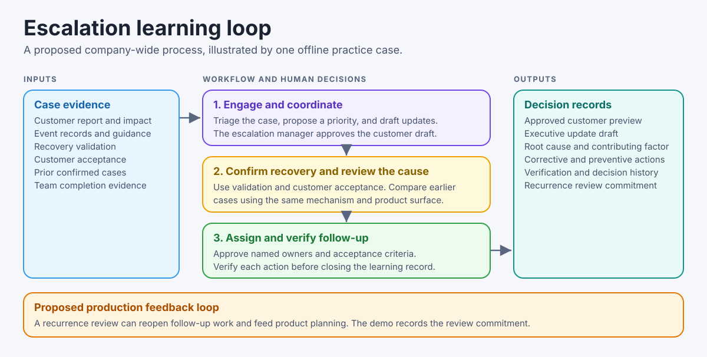
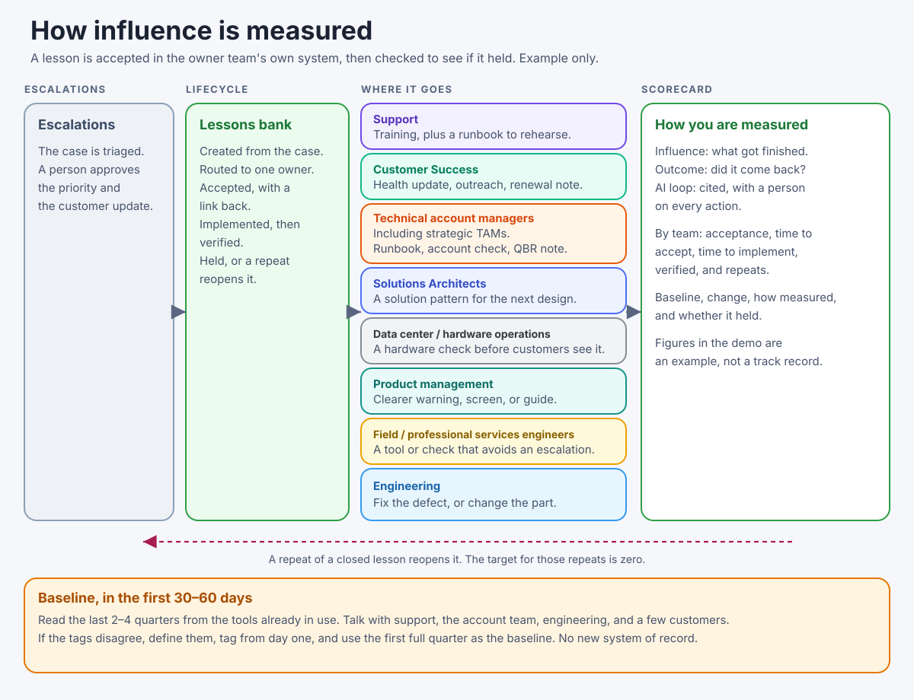
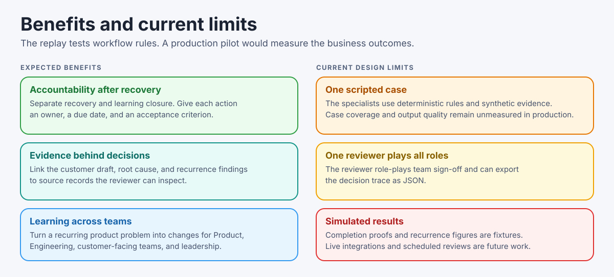
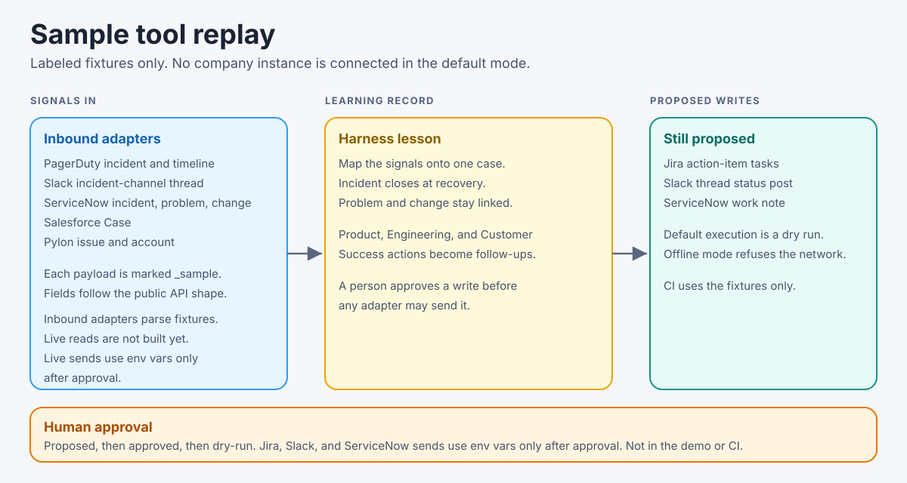

# Escalation Learning Harness

[Open the live demo](https://escalation-learning-harness.insightfulfeast.chatgpt.site) in your browser. No account or installation required.

A runnable demo that follows a critical customer escalation from the first report to customer recovery, then turns the evidence into corrective and preventive actions. The learning record closes after team owners verify their actions and an executive sponsor reviews the residual risk.



The demo replays a fictional assessment-template discard and a separate launch-picker lookalike. The agents run deterministic rules, the evidence is synthetic, and a single browser session role-plays the people making decisions. The hosted replay keeps decisions in your browser tab and requires no account or API key.

## Walk the case

1. **Engage.** Open the customer report. Run triage, inspect the discard event and rollout impact, then confirm P2. Priority comes from a fictional impact × urgency matrix: one blocked workflow is impact 2, and a deadline inside 24 hours is urgency 1, which maps to P2. See [how this flow maps to ITIL 4 practices](docs/itil-mapping.md).
2. **Coordinate.** Review the executive brief and customer draft. Try the unsupported restore claim to see the approval block. Approve supported wording, revise it, and watch the preview lock again until the new version is approved.
3. **Confirm recovery.** Replay Support's rebuild validation and the customer's acceptance. The customer moves to **Recovered**, the incident closes, and the linked problem stays **Open** in problem identification. Learning stays **Open**.
4. **Learn.** Run the RCA, recurrence, and routing stages. Two prior confirmed discard cases match. A similar launch-picker report is excluded because its mechanism is unverified. Problem control records the workaround and the root cause, so the case becomes a known error with a known error database entry. Handoffs are tagged functional (to a technical team) or hierarchical (up to management).
5. **Verify.** The problem is in error control. Corrective and preventive actions are change requests. Return Engineering’s incomplete submission, replay revised evidence, and verify that each change was effective before executive sign-off. Completion alone does not close the problem.
6. **Review recurrence.** Load both reports after closure. Keep the filter issue separate, then reopen preventive work for a confirmed repeat. Verify revised Engineering proof and executive sign-off again.
7. **Measure.** Read the influence scorecard. It compares an example baseline with this practice quarter, including acceptance, implementation, verification, and repeats for each owner team. Confirming the repeat moves the closed-lesson target off zero, and verifying the revised proof does not erase it. **Export JSON** saves the decision record, including the incident, the open-then-closed problem, the known error, the known error database entry, the change lifecycle, and where each handoff was routed.

[Open a screenshot of the live demo](docs/images/demo-preview.png) · [Read the demo walkthrough](docs/demo-guide.md)

## What each team owns

| Team | Follow-up in the replay |
| --- | --- |
| Engineering | Verify safeguards and regression coverage for irreversible discard |
| Product & Design | Test whether customers understand the warning before they confirm |
| Support | Publish and rehearse a decision tree for discarded drafts and missing templates |
| Customer Success | Record customer acceptance and check readiness for the next rollout |
| Documentation & Enablement | Publish safe draft-editing and rebuild guidance |
| Operations & Analytics | Measure confirmed repeat escalations per 100 draft edits |
| Executive leadership | Review residual risk after team verification and set the next review |

The escalation manager owns the case, confirms priority and recovery, approves the follow-up plan, and closes the learning record. Each action carries an owner, due date, evidence references, and an acceptance criterion. See the [roles and decisions visual](docs/images/main-players.svg).

## How influence is measured



After the learning record closes, the Measure step opens an influence scorecard. Four of the follow-ups are lessons on this case: Engineering, Support, and Product management. Solutions architects, data center and hardware operations, field engineers, Customer Success, and technical account managers appear in the example quarter so those teams are visible. On this case, Customer Success, Operations, and executive sign-off stay as acceptance, measurement, and residual-risk review. The scorecard compares this example quarter with a baseline from three earlier example quarters, and reads each team for acceptance, time to accept, time to implement, verified share, and repeats. Every figure is synthetic. A repeat reopens the lesson, and the repeat still counts after the revised proof is verified.

The same example quarter can be read as lesson velocity: how long a verified lesson takes to become a measured customer outcome, which open lessons are worth the effort, and how that wait differs by owner team. The charts are example data. [Lesson velocity](docs/lesson-velocity.md) is the write-up. Regenerate the images with `python3 scripts/make_charts.py` after `python3 -m pip install -r requirements-dev.txt`.

[How influence is measured](docs/measuring-influence.md) covers the lifecycle, the routing, the three metric groups, the 30–60 day baseline, and an [example systems mapping](systems-mapping.example.json) for reading the same fields from tools an organization already uses. That mapping names a common stack. It does not name a target organization. A planned handoff of verified lessons into Runbook Copilot is described there and is not built.

## Benefits and boundaries



The replay demonstrates source-linked drafts, explicit recovery and closure decisions, and routing based on recurrence. The example reduction from **3 to 1 confirmed discards per 100 edits** is synthetic. A production pilot would measure repeat escalations, follow-up completion, and time to verified closure. The demo records a 30-day review commitment without scheduling it.

- [What changed and why](docs/iteration.md) compares the first release, review findings, and rerun results.
- [Design notes](docs/design.md) describe inputs, outputs, code structure, and proposed production work.
- [How this flow maps to ITIL 4 practices](docs/itil-mapping.md) names the incident, problem, known error, change, escalation, and measurement terms the demo is using. It is a mapping, not a certification or an adoption claim.
- [Demo walkthrough](docs/demo-guide.md) includes the main path and what to inspect at each decision.
- [Evaluation notes](docs/evaluation.md) explain what CI checks and what remains outside the test set.
- [Reliability notes](docs/reliability.md) record measured failure and recovery cases from the local harness. The demo does not call a model.

## Tool adapters

The same fictional case can be replayed from labeled sample payloads for PagerDuty, Slack, ServiceNow, Salesforce, and Pylon. Inbound adapters parse those documented API shapes from fixtures. Live reads are not built yet. Lessons for Engineering, Product, and Customer Success become proposed Jira tasks, a Slack status post, and ServiceNow work notes on the incident and the change request. The sample links the incident to the problem and the problem to the change request. Those writes stay proposed until a person approves them. A live send for Jira, Slack, or ServiceNow uses environment variables only after that approval, and the default is a dry run.



Nothing in that path signs in to a company instance. CI uses the fixtures only. [Tool adapters](docs/integrations.md) lists the public API fields, the environment variables a live send would need, and the approval rule. From a local checkout the replay is at [127.0.0.1:8796/integrations.html](http://127.0.0.1:8796/integrations.html) after `python3 serve.py`.

## Maintainer verification

These commands are optional. They check the fixtures on a machine that already has the repository. They are not required to use the hosted case.

GitHub Actions runs the three Python checks below, installs the optional chart dependency, builds the lesson-velocity charts, then compares the generated browser replay with the Python scorecard. See the [workflow](.github/workflows/evals.yml). That comparison is maintainer verification. It is not a hosted evaluation panel. A local server is also optional: from a checkout, `python3 serve.py` listens on [127.0.0.1:8796](http://127.0.0.1:8796). Python 3.11 or newer and the standard library are enough for the demo and the checks above. matplotlib is an optional dependency for regenerating the lesson-velocity charts (`requirements-dev.txt`). Without it, the chart test skips and the other checks still run. Node is needed only for the replay comparison. If that port is in use, pass `--port 8797`.

```sh
python3 assessment_check.py --copilot-path .
python3 -m unittest -v
python3 workflow_eval.py
python3 -m pip install -r requirements-dev.txt
python3 scripts/make_charts.py
```

## Prior work and license

The demo reuses the prior assessment workflow built on [Runbook Copilot](https://github.com/itskeeeyin/runbook-copilot/tree/d40faf4) and the golden-case approach from [Copilot Evals](https://github.com/itskeeeyin/copilot-evals/tree/60d8e98). The diagrams follow the visual style of those repos. See [MIT license and attribution](LICENSE).
