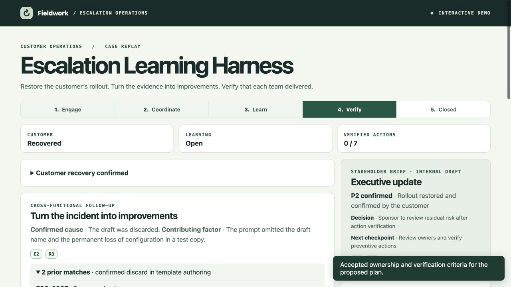

# Five-minute rehearsal

## 1. Establish impact

Open the [live browser demo](https://escalation-learning-harness.insightfulfeast.chatgpt.site/). For the local Python version, run `python3 serve.py` and visit [localhost](http://127.0.0.1:8796). Start at **Engage** and read E1. Run triage, then open E2 and E3. Show that telemetry identifies a draft discard and that one rollout is at risk. Confirm P2. The executive brief shows the next checkpoint and links to the evidence.

## 2. Show how the draft guard works

Try **Try unsupported restore claim**. The draft remains locked and cites the guidance that contradicts restoration. Select **Restore supported wording**, approve it, then **Revise wording** to show that approval belongs to one version. Approve the revised draft.

## 3. Separate recovery from learning

Select **Replay recovery evidence**, inspect R1 and R2, and confirm customer recovery. Support validated the rebuilt template and the fictional customer accepted the outcome. The customer status is **Recovered** and learning stays **Open**.

## 4. Review what the case teaches

Run the learning agents. Read R3 for the prompt design finding. Open the prior-case section. ESC-0987 and ESC-1011 match on confirmed discard in template authoring. ESC-1043 describes a missing template in the launch picker and stays excluded. Compare the Engineering safeguard, Product usability check, and Operations recurrence measure.

## 5. Close on verified outcomes

Approve the plan and replay completion evidence. Verify each action using the stated acceptance criterion and the simulated proof. Executive verification becomes available after the other six actions are verified. Close learning and export the JSON. The file includes the decisions, action evidence, and the recurrence review owner and interval.

## Suggested opening

> This is a fictional assessment-template escalation. I’ll show how the escalation manager restores the customer’s rollout, then keeps the learning work open until the teams can show what changed.

## Suggested close

> The same evidence explains the customer outcome, the product issue, and the work each team owns. In a real pilot, I’d look for fewer confirmed repeat incidents relative to product usage and track whether owners verify their actions on time.
