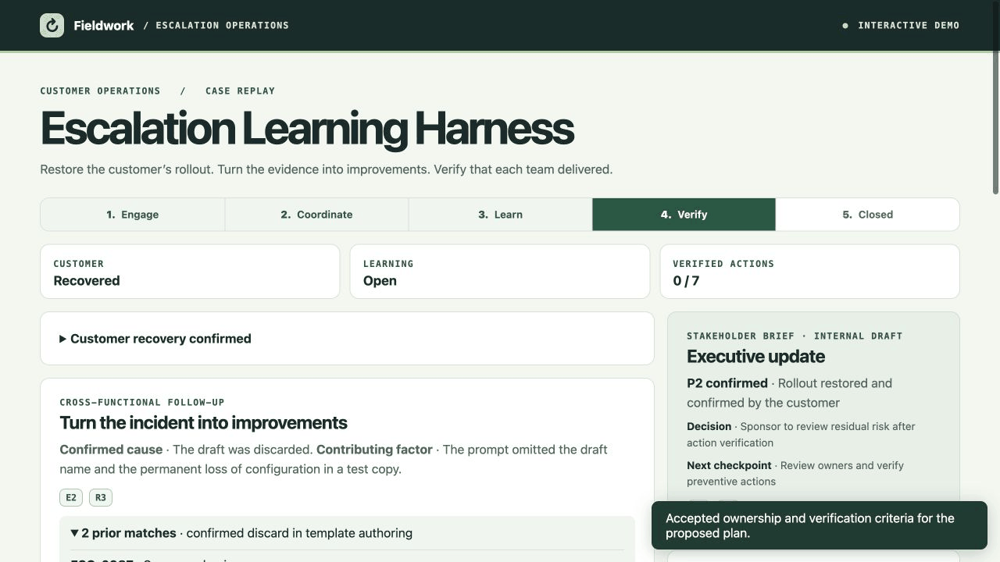

# Demo walkthrough

## 1. Establish impact

Open the [live browser demo](https://escalation-learning-harness.insightfulfeast.chatgpt.site/). Start at **Engage** and read E1. Run triage, then open E2 and E3. Telemetry identifies a draft discard and one rollout is at risk. Confirm P2. The example matrix scores that as impact 2 and urgency 1. The executive brief shows the next checkpoint and links to the evidence. The brief is a hierarchical escalation. Support's rebuild is a functional one. [How this flow maps to ITIL 4 practices](itil-mapping.md) is the term guide.

## 2. Show how the draft guard works

Try **Try unsupported restore claim**. The draft remains locked and cites the guidance that contradicts restoration. Select **Restore supported wording**, approve it, then **Revise wording** to show that approval belongs to one version. Approve the revised draft.

## 3. Separate recovery from learning

Select **Replay recovery evidence**, inspect R1 and R2, and confirm customer recovery. Support validated the rebuilt template and the fictional customer accepted the outcome. The customer status is **Recovered**, the incident closes, and the linked problem stays open in problem identification. Learning stays **Open**.

## 4. Review what the case teaches

Run the learning agents. Read R3 for the prompt design finding. Open the prior-case section. ESC-0987 and ESC-1011 match on confirmed discard in template authoring. ESC-1043 describes a missing template in the launch picker and stays excluded. Problem control writes the workaround and the root cause, which creates known error KE-1042 and known error database entry KEDB-1042. Compare the Engineering safeguard, Product usability check, and Operations recurrence measure. Each card is tagged functional or hierarchical.

## 5. Review incomplete proof

Approve the plan. The problem moves to error control, and corrective and preventive actions become authorized changes. Replay completion evidence. Engineering initially supplies only a merged PR, so the change is implemented and not yet effective. Open V1, return the submission, and replay the revised evidence. Open V2 and verify Engineering. Verify the other owners, record executive sign-off, and close learning. The problem closes only after those changes are verified effective.

## 6. Reopen a confirmed repeat

Closing learning opens the **Measure** step. The influence scorecard is example data, and closed-lesson repeats are at the target of zero.

In the 30-day review, load **Report A** and keep it separate. A published template hidden by a solution filter has a different mechanism. Load **Report B** and confirm the repeat. The customer remains **Recovered** while Engineering and executive sign-off reopen. The step returns to **Verify**, and the repeat tile says the target was missed. Replay the revised proof, inspect V3, verify both owners, and reclose. The original V2 evidence remains in the trace.

## 7. Read whether it held

The **Measure** step shows the scorecard again. The Engineering lesson is verified, and the repeat is still 1. Template authoring includes that extra escalation. The routing board shows where each lesson went, and the team section shows acceptance, time to accept, time to implement, verified share, and repeats. This case has no field tool, Customer Success playbook, or TAM review. Solutions architects, data center and hardware operations, field engineers, Customer Success, and technical account managers are marked example quarter. The systems list is an example of reading those fields from tools a company already uses. It is not a live connection. **Export JSON** includes `owner_type`, `action_type`, `lifecycle`, the accepted link, the routed, implemented, and shipped dates, and `recurrence` on each lesson. It also includes `records` (incident, problem, known error, known error database), `changes`, and `handoffs`.

## Alternate case

Restart and select **Try the launch-picker case**. Inspect the publish and filter evidence. Attempting to route it as draft discard is blocked. Route it to launch-picker Support and confirm launch readiness. This case has its own evidence and recovery record.

## What this walkthrough shows

The same evidence explains the customer outcome, the product issue, and the work each team owns. The scorecard asks whether that work held: the baseline, the change, how it is measured, and whether it held. The figures on the page are an example. A baseline comes from the people who hold the history. A lesson reopens when the same mechanism comes back.
