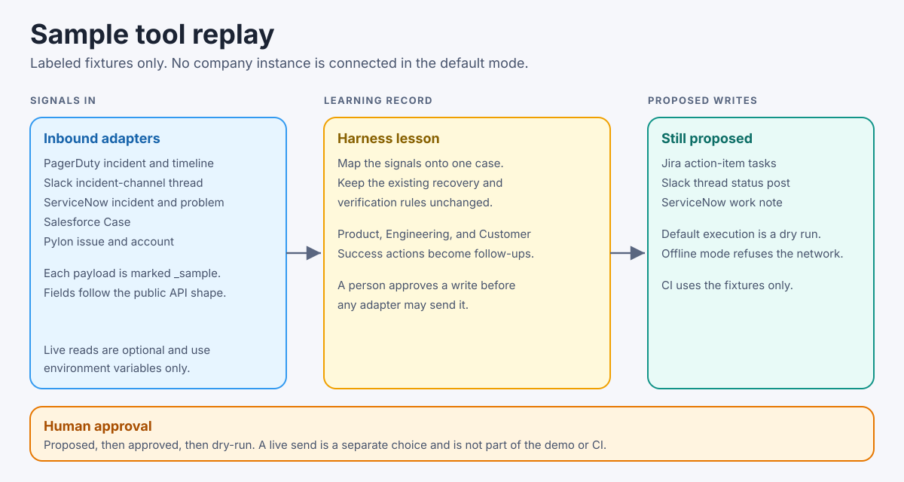

# Tool adapters

The learning harness can read escalation signals from the systems a support organization already uses, and it can propose follow-up writes back to those systems. The default path is offline. CI and the hosted demo load labeled sample payloads from [integrations/fixtures](../integrations/fixtures). They do not call ServiceNow, Pylon, Salesforce, Jira, PagerDuty, or Slack.

## What each adapter does

| Tool | Direction | Sample payload | Public shape used |
| --- | --- | --- | --- |
| PagerDuty | In | Webhook `incident.triggered` and log entries | Incident `id`, `status`, `urgency`, `html_url`; v3 webhook `event.event_type` and `event.data`; log entry `type` |
| Slack | In, and a proposed status post | `conversations.replies` thread | `messages[].ts`, `thread_ts`, `text`; outbound `chat.postMessage` body |
| ServiceNow | In, and a proposed work note | Table API incident and problem | `sys_id`, `number`, `state`, `priority`, `short_description`; PATCH `work_notes` |
| Salesforce | In | SOQL Case query | `Id`, `CaseNumber`, `Subject`, `Status`, `Priority`, `AccountId` |
| Pylon | In | Issue and account | `data.id`, `number`, `title`, `body_html`, `state`, `account`, `link` |
| Jira | Out | Create-issue request built from the lesson | REST v3 `fields.project`, `summary`, `issuetype`, description `doc` |

Doc pages cited in the adapter modules:

- PagerDuty incident, webhooks, and log entries: [get an incident](https://docs.pagerduty.com/developer/api/reference/rest/incidents/get-incident), [webhooks](https://docs.pagerduty.com/developer/webhooks-overview), [list log entries](https://docs.pagerduty.com/developer/api/reference/rest/log-entries/list-log-entries)
- Slack: [conversations.replies](https://api.slack.com/methods/conversations.replies), [chat.postMessage](https://api.slack.com/methods/chat.postMessage)
- ServiceNow Table API: [Table API](https://www.servicenow.com/docs/r/xanadu/api-reference/rest-apis/c_TableAPI.html)
- Salesforce Case: [Case object](https://developer.salesforce.com/docs/atlas.en-us.object_reference.meta/object_reference/sforce_api_objects_case.htm), [query](https://developer.salesforce.com/docs/atlas.en-us.api_rest.meta/api_rest/dome_query.htm)
- Pylon: [issues](https://docs.usepylon.com/pylon-docs/developer/api/api-reference/issues), [conventions](https://docs.usepylon.com/pylon-docs/developer/api/conventions)
- Jira: [create issue](https://developer.atlassian.com/cloud/jira/platform/rest/v3/api-group-issues/#api-rest-api-3-issue-post)

State values in the fixtures are the vendors' documented defaults (for example ServiceNow incident `6` means Resolved, Pylon `closed`, PagerDuty `triggered`). A tenant can rename statuses. The adapters reject a status they do not recognize instead of guessing.

## Sample replay

`integrations/replay.py` walks one fictional case, ESC-1042:

1. PagerDuty page and timeline.
2. Slack incident-channel thread.
3. ServiceNow incident (resolved) and problem (root-cause analysis).
4. Salesforce Case (closed).
5. Pylon issue and account.
6. Lesson for Engineering, Product, and Customer Success, using the titles and acceptance criteria already in `scenario.json`.
7. Proposed Jira tasks, a Slack status post, and a ServiceNow work note.

The replay approves only the Engineering Jira task and then dry-runs it. The dry run returns the request body and sets `network` to false. The other writes stay `proposed`.

The browser page [web/integrations.html](../web/integrations.html) renders that replay. From a checkout, `python3 serve.py` serves it at [127.0.0.1:8796/integrations.html](http://127.0.0.1:8796/integrations.html). The hosted build copies the same page next to the practice case. The page has no credentials and no send button.

## Live mode

Set `INTEGRATIONS_MODE=live` and provide only the variables for the call you intend to make. The process reads them from the environment. Do not commit them.

| Call | Variables |
| --- | --- |
| Jira create issue | `JIRA_BASE_URL`, `JIRA_EMAIL`, `JIRA_API_TOKEN`, optional `JIRA_PROJECT` (default `LEARN`) |
| Slack post | `SLACK_BOT_TOKEN` |
| ServiceNow work note | `SERVICENOW_INSTANCE`, `SERVICENOW_USER`, `SERVICENOW_PASSWORD` |

A write still has to be approved first (`state` moves from `proposed` to `approved`). Execution defaults to `dry_run=True`. `dry_run=False` while mode is `offline` returns status `refused` and does not open a socket. CI does not set `INTEGRATIONS_MODE=live`.

Inbound live reads (listing PagerDuty incidents, querying Salesforce, searching Pylon) are not implemented. The adapters parse the documented response shapes from fixtures. Adding a live read later should use the same environment-variable rule and stay out of CI.
