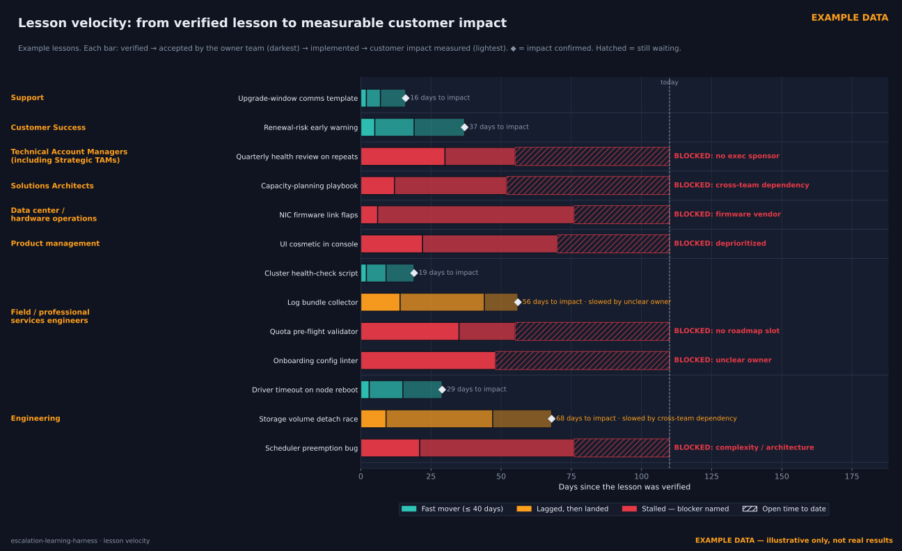
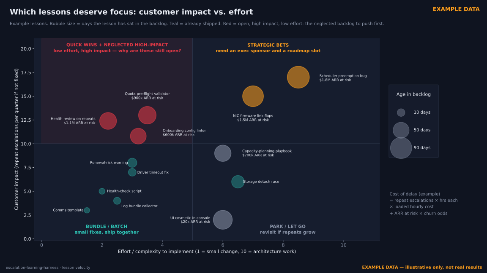
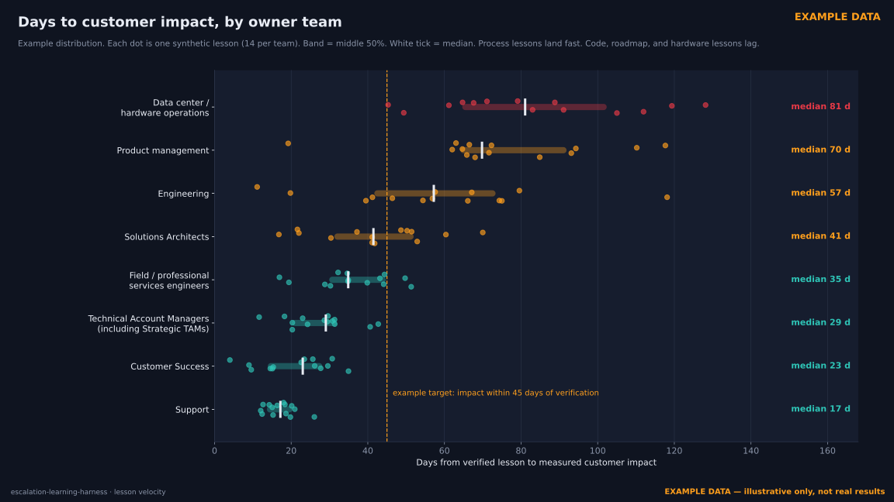

# Lesson velocity

A lesson counts when it changes something for the customer. This page is how to see which lessons move, which ones sit, and how to unstick the ones that stall.

All numbers, lessons, and charts on this page are example data. They are not the practice case, they are not a report of live escalations, and they are not results from any company.

The same charts are on [Measuring influence](measuring-influence.md). Regenerate them from [lesson-velocity.example.json](../examples/lesson-velocity.example.json):

```sh
python3 -m pip install -r requirements-dev.txt
python3 scripts/make_charts.py
```

**Swimlanes.** One row per lesson. The bar runs from a verified finding to acceptance, implementation, and measured impact. A diamond means impact was confirmed. A hatched tail is still open, and the blocker is named on the row.



**Impact and effort.** Customer impact against the effort to implement. Bubble size is days in the backlog. Teal has already shipped. Red is open, high impact, and low effort.



**Days to impact, by owner team.** Each dot is a synthetic lesson drawn so the spread is visible. The band is the middle 50 percent. The white tick is the median.



## What velocity means

The lesson record moves through the same stages as the [scorecard](measuring-influence.md):

**Created → Routed → Accepted (in the owner team's own system) → Implemented → Verified → Held (no repeat for 30 days)**

The finish line for velocity is **customer impact measured**. That is fewer repeat escalations, a faster time to resolve, or a risk removed from a renewal.

On the charts, the clock starts when the lesson is a verified finding: the root cause is confirmed and the lesson is ready for an owner. Each swimlane bar is then three bands:

| Band | What it covers |
| --- | --- |
| Accepted, darkest | Time until the owner team takes the lesson into its own system |
| Implemented | Time until the change, training, tool, procedure, or guide is in place |
| Impact, lightest | Time until the customer outcome is measured |

The scorecard uses Verified for the evidence check after implementation, and Held for 30 days with no repeat. Those checks sit on the way to impact. Impact measured is the outcome they are there to prove.

## How to measure it

| Measure | How | Why it matters |
| --- | --- | --- |
| Time in each stage | Timestamp each transition. Report the median and the 80th percentile per team. | Shows where lessons wait. Slow acceptance and slow implementation are different problems. |
| Aging | Days since verification for every open lesson, in buckets of 0–30, 31–60, 61–90, and 90+. | The backlog that is hard to see is the one that keeps costing the customer. |
| Blocked reason code | Required when a lesson sits in one stage longer than its target. One code from the list below. | Turns "it is stuck" into a pattern that can be fixed. |
| Days to impact | From verification to the first measured improvement. | The number a review can act on. |
| Repeats while waiting | Escalations that match an open lesson's root cause. | The running cost of waiting. |
| Held rate | Share of implemented lessons with no repeat in 30 days. | Shows the fix held, rather than a ticket that merely closed. |

Blocked reason codes, kept to this list:

- cross-team dependency
- no roadmap slot
- firmware vendor
- unclear owner
- complexity / architecture
- no exec sponsor
- waiting on customer data
- deprioritized

Deprioritized includes the name of the person who decided and the reason. A firmware vendor code is the third-party case: the wait is outside the owner team, and someone still owns the interim mitigation.

## Why some lessons lag

These are patterns to test. In the example data, process lessons land in about two to four weeks. Code, roadmap, and hardware lessons take about two to three months.

1. **Process lessons need one owner. Code lessons need a roadmap slot.** Support, Customer Success, and technical account managers can adopt a lesson with one lead. Engineering and Product management lessons compete with planned work, so they wait for the next planning cycle.
2. **Unclear ownership leaves a lesson in Routed.** A tool that both field engineers and Support would use sits still when each team assumes the other owns it.
3. **The cost is invisible to the person who decides.** Engineering sees a ticket. The ticket does not show the repeat escalations each quarter, or the renewal it puts at risk.
4. **A large lesson has no sponsor.** An architecture-level fix needs someone who can trade roadmap time. Without that person it is re-triaged every sprint and never starts.
5. **A vendor or hardware dependency has no shared clock.** A firmware fix waits on a third party. Data center / hardware operations feels that wait. Someone still has to own the chase and an interim mitigation.
6. **Small lessons lose to large ones.** A fix that is trivial on its own never wins a planning meeting, even when a handful of them would remove a lot of toil.

Each pattern predicts a blocked reason code. After one quarter of tagging, keep the code or drop it.

## Rank by cost of delay

Rank open lessons by **cost of delay per month**.

> **Cost of delay per month**
> = (repeat escalations per month × hours per escalation × loaded hourly cost)
> + (engineer hours spent on workarounds × hourly cost)
> + (ARR on affected accounts × estimated added churn risk)

The worked examples use a loaded cost of $150 an hour. The churn term is left as ARR at risk. The odds are a judgment, and the table keeps that judgment visible instead of folding it into the dollar figure. The dollar column is the labor term only.

Quota pre-flight validator, as a check: (4 × 6 × $150) + (10 × $150) = $3,600 + $1,500 = $5,100.

| Rank | Lesson | Owner | Repeats per month | Hours each | Workaround hours per month | ARR on affected accounts | Labor cost of delay per month | Blocker |
| --- | --- | --- | --- | --- | --- | --- | --- | --- |
| 1 | Scheduler preemption bug | Engineering | 6 | 8 | 20 | $1.8M | $10,200 | complexity / architecture |
| 2 | Quota pre-flight validator | Field / professional services engineers | 4 | 6 | 10 | $900k | $5,100 | no roadmap slot |
| 3 | Onboarding config linter | Field / professional services engineers | 3 | 5 | 8 | $600k | $3,450 | unclear owner |
| 4 | Quarterly health review on repeats | Technical Account Managers (including Strategic TAMs) | 4 | 3 | 0 | $1.1M | $1,800 | no exec sponsor |

Sorting by labor cost puts the scheduler bug first. It is also the highest effort: an architecture change, in the strategic-bets quadrant. The monthly review still pulls the red quadrant forward in the same meeting, because those lessons can move without a planning cycle. Quota, the linter, and the health review are low effort and high impact. The scheduler bug goes to a sponsor with its cost of delay attached.

## Monthly lesson review

Thirty minutes, once a month.

- **Who:** a lead from each owner team, plus a product partner and a technical account manager or Customer Success lead.
- **Agenda:** the aging buckets, the top lessons by cost of delay, a decision on each one, and the lessons that have held since last month.
- **Decision:** accept with a date, bundle, park with a reason, or escalate.
- **Rule:** every lesson leaves with an owner and a date, or with an explicit reason it will not be done. A clear no is a decision. A silent maybe is how a lesson ages past 90 days.

## Aging targets

These are example targets for the review. They are not a policy already in force.

- Routed to accepted: **10 business days**. After that, the owner team's manager gets a nudge.
- Accepted to implemented: **45 days** for a process or tool lesson, or a committed roadmap quarter for code.
- Over the target: the lesson goes on the monthly review. Twice over: it goes on the quarterly readout with its cost of delay.

The days-to-impact chart draws the 45-day line as that example target. In the example distribution, Support, Customer Success, technical account managers, and field engineers land at or under it. Solutions architects sit on it. Engineering, Product management, and data center / hardware operations sit past it.

## Bundle small lessons

Group three to five small, related fixes into one supportability pack. One ticket, one owner, one combined cost of delay. A pack worth 12 repeat escalations a quarter can win a planning slot that four separate tickets, each worth three, will not.

## A sponsor for each strategic lesson

Anything in the strategic-bets quadrant gets a named sponsor who can trade roadmap time. The sponsor's work is to decide yes or no in the next planning cycle, and to remove one blocker. Without a sponsor, a strategic lesson stays a wish that is re-triaged and never started.

## Moves that unstick a lesson

The aim is a well-informed decision, made quickly by the person who can say yes. Each move below makes that decision easier to make.

1. **Map who can say yes and who feels the repeats.** High authority and low attention is where most lessons stall. That is where the time goes.
2. **Learn what that person is measured on this quarter.** Know the goals, the planning calendar, and the problems they already want solved, before asking for anything.
3. **Frame the lesson in those terms.**
   - Engineering: toil, repeat interrupts, on-call load, roadmap risk.
   - Product management: adoption, churn, time to value, support cost per customer.
   - Customer Success and technical account managers: renewal risk, health scores, executive relationships.
   - Solutions architects: a pattern the next design can reuse.
   - Field / professional services engineers: a check that closes the issue without an escalation.
   - Data center / hardware operations: a fault caught before customers see it.
   - Support: a runbook the team can rehearse.
   - An executive: ARR at risk, customer trust, cost to serve.
4. **Talk before the review.** A large ask should not appear for the first time in the group meeting. Walk the decision maker through it, hear the objection, and adjust the proposal first.
5. **Put one customer quote next to the repeat count.** Either one alone is easier to set aside.
6. **Bring the teams who feel the same pain.** Technical account managers, solutions architects, and support leads often have the same repeats. A lesson raised by three teams is a priority. Raised by one, it is easier to defer.
7. **Do the legwork.** Bring a drafted ticket, a repro, a customer-impact summary, and a proposed acceptance test. Lower the cost of saying yes.
8. **Name the trade.** Ask what drops if this goes in, and suggest an answer. A vague ask is easy to decline. A clear swap is a decision.
9. **Make the age visible, and give the credit away.** A shared scorecard and a quarterly readout show an aging lesson without blaming the owner. When the lesson lands and holds, the owner team gets the credit.
10. **Escalate once, and record a no.** Escalate when the cost of delay is high, the target has been missed twice, and a direct conversation has already happened. Record the decision and let it go when the owner has made an informed no, or when the repeats have stopped. Open the lesson again if the data changes.

### Example moves

**No roadmap slot, and the effort is small (quota pre-flight validator).**
Talk with the engineering manager first. The lesson is about four repeat escalations a month and about ten hours of workaround time. The ticket is already drafted, two repros are attached, and the acceptance test is written. Ask whether it can go into the next sprint as a small item. Bring it to the review only if that conversation cannot get a date. The terms are toil.

**Unclear owner (onboarding config linter).**
Put the field-services lead and the support lead in one 20-minute call with a one-page note: the problem, three options for who owns it, and a recommendation. Ask them to pick one before the call ends. Record the owner on the lesson. The terms are clarity. The call removes a standing question from both calendars.

**No executive sponsor, and the effort is an architecture change (scheduler preemption bug).**
Work with the technical account manager on the two largest affected accounts. One slide: ARR exposed, the repeat count, the interim workaround, and its cost. Take it to the person who owns that platform area, ahead of planning, and ask one question: will you sponsor a yes or no in the next planning cycle? The terms are ARR at risk and customer trust.

**A vendor dependency (NIC firmware link flaps).**
The vendor's schedule will not move because a lesson asks it to. Shrink the impact in the meantime. Agree an interim mitigation with data center / hardware operations, publish it as a support runbook, and set a check-in date with the vendor contact. On the scorecard, report the lesson as mitigated, with the root-cause fix still open. Repeats can fall now, and the long fix stays visible. The terms are customer impact this week, and an honest status on the remaining fix.

## What good looks like

Example targets after two quarters of this review:

- Median days to impact down by about a third for process and tool lessons.
- No open lesson older than 90 days without either a sponsor or a recorded decision.
- A blocked reason code on every lesson over its target.
- Held rate, no repeat in 30 days, of 80 percent or more on implemented lessons.
- Every owner team can see its own row, and is credited when its lessons land.

The owner teams are the eight on the scorecard: Support, Customer Success, Technical Account Managers (including Strategic TAMs), Solutions Architects, Data center / hardware operations, Product management, Field / professional services engineers, and Engineering.

Charts are generated by `scripts/make_charts.py`. All of the data is example data.
