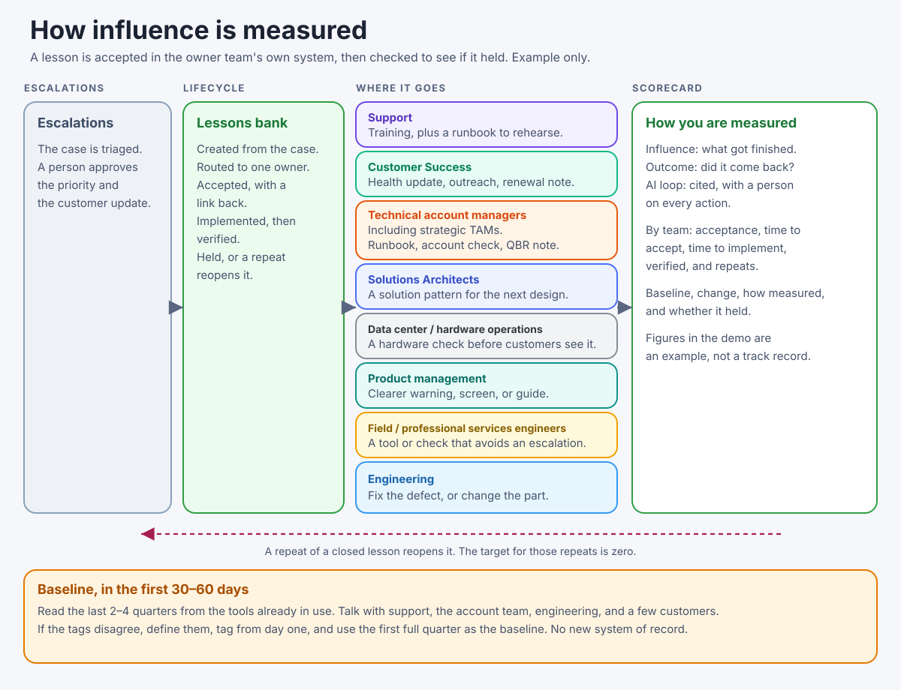
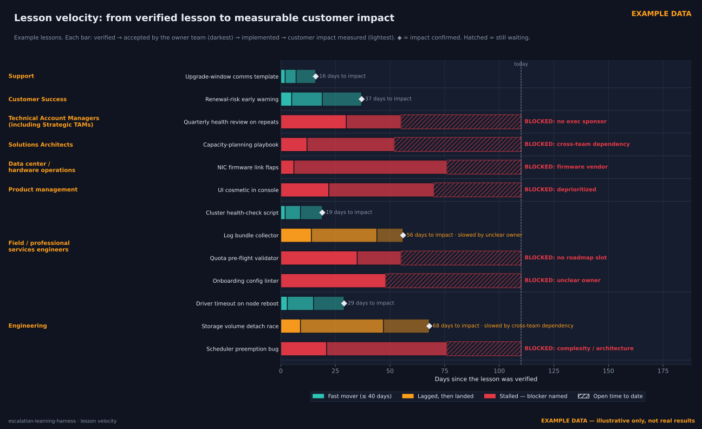
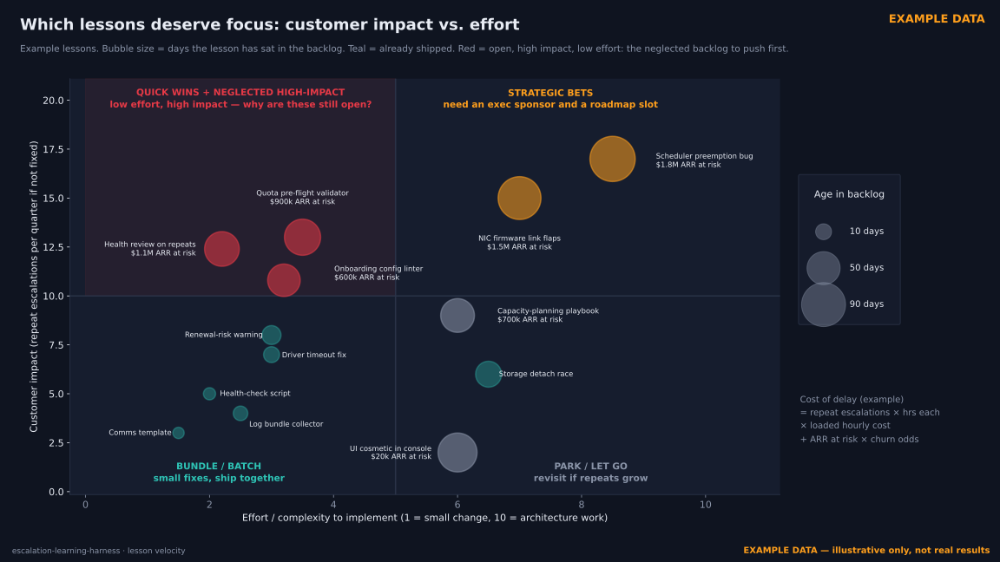
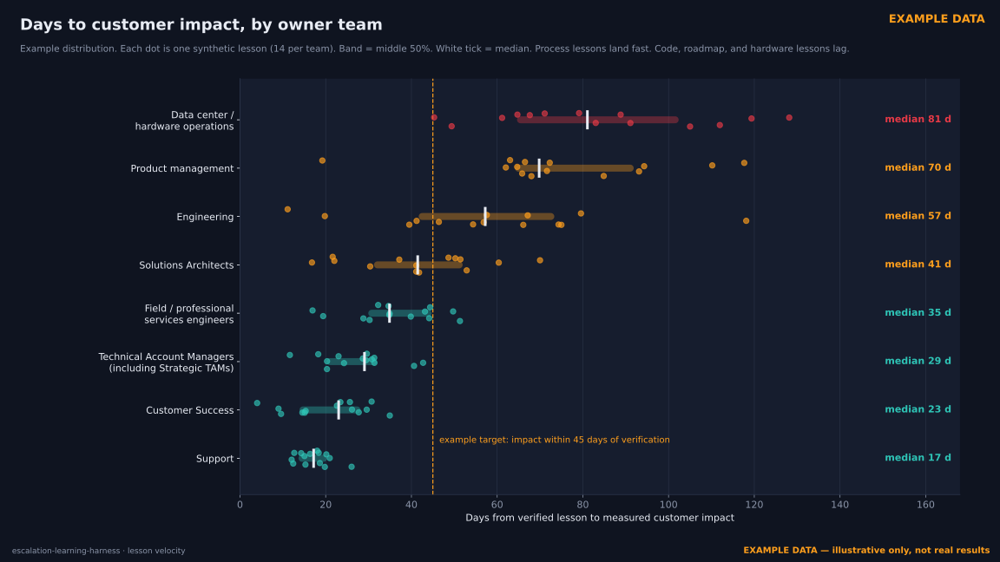

# Measuring an escalation manager's influence

Recovery is not the end of the case. A verified lesson has to reach the team that can stop the same problem, and the next quarter has to show whether that held. How long that takes is [lesson velocity](lesson-velocity.md).

This page is the method. The figures in the [practice demo](https://escalation-learning-harness.insightfulfeast.chatgpt.site/) are a worked example built from synthetic tickets. They are not a report of live escalations, and they are not a personal track record.

## The lesson lifecycle

A lesson moves through six stages. The same names are the statuses a deployment would read from the lesson record. This repo does not add a new system to hold them.

| Stage | What it means |
| --- | --- |
| Created | The escalation is open and the lesson exists. The root cause is not yet routed. |
| Routed | One owner team is named, within the routing window. |
| Accepted | That team has the lesson in its own system, and that record links back to the lesson. |
| Implemented | The change, training, tool, procedure, or guide is in place. |
| Verified | The evidence is checked and a person has signed off. |
| Held | Verified, and the same confirmed mechanism has not come back for 30 days. |

A recurrence sets the lesson back to reopened. Verifying the revised proof closes it again and does not erase the repeat. The target for repeats on closed lessons is zero. Held is not "better than the baseline." It means the hold window passed with no recurrence.

## Where a lesson goes

An escalation is triaged, and a person approves the priority and the customer update. The harness then produces a lesson only when the root cause is confirmed, an owner is named, and an executive has signed off. Those lessons are the lessons bank.

Each lesson is routed to one owner team:

| Owner team | What "done" looks like | Where that team accepts it, in the example mapping |
| --- | --- | --- |
| Support | Training closes an expertise gap, and a runbook is published | Zendesk |
| Customer Success | Account health or playbook update, outreach to affected customers, and a renewal-risk note | CRM success-plan task. The example is Salesforce |
| Technical Account Managers, including strategic TAMs | Customer-specific runbook or architecture review, a check across their accounts, and a QBR follow-up | CRM success-plan task, linked to the account and any open renewal. The example is Salesforce |
| Solutions Architects | A solution pattern the account team can apply on the next design | Jira |
| Data center / hardware operations | A check or procedure so the same hardware fault is caught before customers see it | Jira |
| Product management | The warning, the screen, or the guide is clear enough that customers do the safe thing | Jira |
| Field / professional services engineers | A tool or check solves the issue without an escalation | Jira |
| Engineering | A defect is fixed, or the component changes so the issue cannot recur | Jira |

The practice case routes four lessons: a discard-path defect to Engineering, a decision-tree runbook to Support, and a warning plus a guide to Product management. It does not add a field tool, a solution-architect pattern, a hardware check, a Customer Success playbook, or a TAM review. The example quarter includes those, and the scorecard marks them as example quarter rather than this case.

For Customer Success, implemented means the account health or playbook is updated, affected customers have been contacted, and a renewal-risk note is on the account. Verified means the CSM lead has signed off.

For technical account managers, including strategic TAMs, implemented means a customer-specific runbook or architecture review is done, a proactive check has run across their accounts, and the QBR follow-up is recorded. Verified means the TAM manager has signed off. Strategic accounts use the same kind of record.

On this practice case, three follow-ups stay beside the lessons. Customer Success records the customer's acceptance of the rollout. Operations carries the measurement. Executive leadership signs the residual risk. Those three are not a second copy of a lesson. The learning record cannot close until they are verified. Customer Success lessons about account health, and TAM lessons about the book of accounts, are in the example quarter.

A later case with the same confirmed mechanism and the same product surface is a repeat. The lesson reopens. Verifying the revised proof does not erase the repeat. The target for repeats on closed lessons is zero.

## The scorecard

The scorecard has three groups. Every metric is read the same way: the baseline, the change, how it is measured, and whether it held.

**Influence** is what the escalation manager got finished.

- Lessons verified and closed. A lesson in rework is not closed.
- The share routed to a named owner within 5 days.
- Defects and architecture changes shipped from lessons. A later repeat does not undo the ship.
- Training and runbooks published.
- Field tools adopted.

The same quarter is also read **by owner team**: acceptance rate, time to accept, time to implement, the share verified, and repeats on lessons that were closed. A team that never accepted the lesson does not get a verified mark. Quarters with no lesson for that team are left out of its baseline.

**Outcome** is whether the problem stopped coming back.

- Repeat escalations on closed lessons. Target: zero. A recurrence reopens the lesson.
- Escalation rate by product area, per 100 in-scope product actions. The rate can improve while a single closed lesson still missed. Those are different questions.
- Time to the first honest customer update: a person approved it, and it does not claim a fix the product cannot do.
- Issues solved in the field without an escalation. The practice case itself is an escalation, so it is not in that count.

**AI loop** is whether the tools stayed reviewable.

- Copilot eval score against a floor. In this repo the number is an example figure. The replay does not run a model or read CI.
- Runbook answers cited correctly. On this case, every cited source has to be an evidence id on the decision record.
- Human approval on every action. An agent may draft. A person approves the customer update, the plan, and each verification.

## How to establish a baseline

The first 30–60 days build the baseline, before any number is treated as a result.

Read the last two to four quarters of ticket and escalation history: escalation rate, repeat rate by cause, time to resolve, which lessons and defects are still open, and the customer signal. Talk with support engineers, the account team, engineering leads, and a few customers. The tickets say what was tagged. The conversations say which tags people trust and which updates customers actually remember.

When the history is messy, write the definitions down. What counts as an escalation. What counts as a repeat. What the first honest update is. What "routed" means. Tag every new case that way from day one. The older quarters stay as context. The first full quarter under those definitions is the baseline.

The demo is the clean case. Its three earlier example quarters already share those definitions, so their average is the baseline, and the practice case sits in the example quarter after them. The baseline panel lists the quarters, the definitions, and four example conversations. The notes are fictional. The customer in them is the Example Privacy Team from the practice case.

## Read it from the tools already in use

The scorecard does not need a new system of record. [systems-mapping.example.json](../systems-mapping.example.json) maps each record and field onto a system an organization already has. The file is an example of a common stack. It does not name a target organization, and it is not a map of any real company's stack. Swap the system names for the ones actually in use.

| Record | Example system | What the scorecard reads |
| --- | --- | --- |
| Escalation ticket | Zendesk | Ticket id, created date, product area, root-cause tag |
| Engineering issue | Jira, ENG project | The implementation, linked back to the lesson |
| Lesson record | Jira, LESSON project | Owner team, lifecycle status, dates, root-cause label |
| Root-cause tag | Zendesk, copied to the Jira label | The confirmed mechanism |
| Owner team | Jira custom field | One of the six teams |
| Lifecycle status | Jira status | Created through held, or reopened |
| Required links | Jira issue links | Ticket, owner-team record, and account. Accepted is not counted without the link back |
| Recurrence flag | Jira checkbox | The repeat that reopens the lesson |
| Account context | Salesforce | Which account the ticket belongs to |
| Success plan | Salesforce, as the example CRM | The task Customer Success or a TAM accepts: health or playbook, outreach, renewal risk, account review, and QBR follow-up. The CSM lead or TAM manager is the verifier |
| Public incident | Statuspage | Only when the escalation is also public. This practice case is not |
| Scorecard | A spreadsheet or BI tool | A view over the lesson rows. Not a new system of record |

This demo does not connect to any of those products. It computes the scorecard from the synthetic decision record. The link-back values use an `example:` prefix so they cannot be mistaken for live records.

## How the demo computes it

On the Measure step, after the learning record closes, the scorecard is calculated from the decision record plus the example history in [measurement.json](../measurement.json). Confirming the repeat on report B moves the closed-lesson repeat off the target and adds one Template authoring escalation. Verifying the revised Engineering proof closes the lesson again and does not put the repeat back to zero. The Engineering row then shows the repeat, and the lesson is verified again rather than held.

**Export JSON** writes the routing on each lesson: `owner_type`, `action_type`, `lifecycle`, `created_on`, `routed_on`, `accepted_on`, `accepted_link`, `implemented_on`, `verified_on`, `shipped_on`, `recurrence`, and `held`. Dates stay empty until that state is earned. `scorecard.inputs` is the example history and the quarter counts the math used, so the figures can be recalculated from the file.

The hosted replay still keeps that record in the browser tab. It does not ask for an account or an API key.

## How to read the scorecard

Read each metric as four things: the baseline, the change, how it is measured, and whether it held.

Influence is the work that got finished. Outcome is whether the problem came back. The AI loop counts when the eval floor held, the answers cite their sources, and a person approved every action. A repeat of a closed lesson reopens it. Held means 30 days with no recurrence. The figures in the demo are a worked example.

## From a verified lesson to measured impact

A verified finding still has to be accepted, implemented, and show up for the customer. The scorecard reads whether that happened. Lesson velocity reads how long it took, and which lessons are still waiting.

The finish line is a measured change: fewer repeat escalations, a faster time to resolve, or a risk removed from a renewal. [Lesson velocity](lesson-velocity.md) is the method for that wait. It covers why some lessons move in a few weeks, how to rank the open ones by cost of delay, and a monthly review for the ones that stall.

The three charts are example data from [lesson-velocity.example.json](../examples/lesson-velocity.example.json). They are not the practice case, they are not a report of live escalations, and they are not results from any company. Regenerate them with `python3 scripts/make_charts.py`.

**Swimlanes.** One row per lesson, from a verified finding through acceptance, implementation, and measured impact. Open rows name the blocker.

**Impact and effort.** Bubble size is how long the lesson has sat. The open, high-impact, low-effort lessons are the ones to push first.

**Days to impact by team.** Each dot is a synthetic lesson. Process lessons land sooner than code, roadmap, and hardware lessons.

## Planned: lessons become reviewed runbook changes

Not built. The practice case stops at the verified lesson.

The intended next step feeds a verified lesson into [Runbook Copilot](https://github.com/itskeeeyin/runbook-copilot) as a reviewed pull request, and adds questions in [Copilot Evals](https://github.com/itskeeeyin/copilot-evals):

- A verified training lesson opens a pull request with the runbook steps, the lesson id, the owner, and the evidence citations. A person reviews it. Verification here does not merge it.
- The eval set gains a question for the confirmed mechanism, and a question for the near miss that must stay excluded. A launch-picker filter problem is not a draft discard.
- CI holds the eval floor. A wrong or uncited answer fails the check.
- If the lesson reopens, the runbook change is not finished. The new question stays in the suite until the revised evidence has been reviewed again.

An agent may draft the pull request. A person decides. That is the same approval rule as the rest of this repo.
